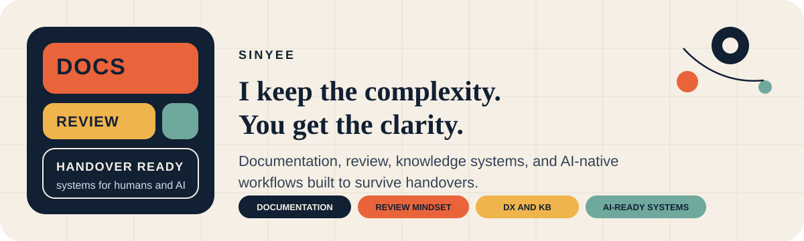

  

  <a href="#english"><strong>English</strong></a>
  &nbsp;&nbsp;|&nbsp;&nbsp;
  <a href="#chinese"><strong>中文</strong></a>

  <code>documentation</code>
  <code>review</code>
  <code>knowledge systems</code>
  <code>AI-ready workflows</code>

  English is the default view. Use the links above to jump between languages.

## English

[Switch to Chinese](#chinese)

> I keep the complexity. You get the clarity.

<table>
  <tr>
    <td valign="top" width="52%">
      <strong>Operating mode</strong>  
      I write documentation, decisions, workflows, and trade-offs down because engineering should not depend on whether I will still be around tomorrow.  
      In practice, I am always preparing for handover.
    </td>
    <td valign="top" width="48%">
      <strong>Working surface</strong>  
      <code>Notion</code> <code>GitHub</code> 
      <code>Notion AI</code> <code>Custom Agents</code> 
      <code>Copilot CLI</code> <code>Gemini Code Assist</code> 
      <code>Codex CLI</code>  
      AI is not an add-on to me. It is part of the interface.
    </td>
  </tr>
</table>

<table>
  <tr>
    <td valign="top" width="33%">
      <strong>Documentation</strong>  
      I do not write docs because docs are cute. I write them because context needs to survive people.
    </td>
    <td valign="top" width="33%">
      <strong>Review</strong>  
      The point is not only to catch mistakes. It is to recognize what looks fine now and becomes an incident later.
    </td>
    <td valign="top" width="34%">
      <strong>AI-native systems</strong>  
      I care about systems that are readable by humans today and ingestible by AI tomorrow.
    </td>
  </tr>
</table>

### What I optimize for

- developer experience that removes friction instead of adding process theater
- knowledge that can survive as a real, reusable knowledge base
- documentation that actually helps the next person
- maintainability and reusability over fragile heroics
- context that future teammates and AI agents can both pick up cleanly
- systems thinking with high-trust collaboration

### What I stay alert to

- vague ownership
- messy workflows
- handover risk
- documentation that says nothing
- low-quality artifacts
- engineering habits that quietly create future incidents

### Why this matters

The first time I told my boss that I was always preparing for handover, the reaction was half amused, half alarmed.

It was still accurate.

Good systems should not depend on one person staying available forever.

I do more than write code. I care about how engineering knowledge, workflows, and decisions become structured, durable systems. Over time I have become convinced that notes, documentation, artifacts, and decision logs will increasingly become inputs for AI ingestion. So I do not only care whether something ships. I care whether the surrounding system gets better.

I am also the kind of reviewer who gets uneasy when workflows are chaotic, ownership is blurry, or documentation says almost nothing. Review is valuable because it catches the quiet stuff early, the things that look harmless now and become expensive later.

### Reading now

- *NASA: Elements of Engineering Excellence*

### Short version

I am not here to protect a seat. I am here to reduce ambiguity, leave durable context behind, and say the uncomfortable thing before it turns into technical debt.

**I keep the complexity. You get the clarity.**

---

## 中文

[Back to English](#english)

> 我喜欢把复杂留给自己，把清晰留给别人。

<table>
  <tr>
    <td valign="top" width="52%">
      <strong>我的工作模式</strong>  
      我会把 documentation、decision、workflow、trade-off 尽量写下来，不是因为我天生热爱写文档，而是因为我一直觉得，工程不该建立在“明天我还在”这件事上。  
      某种程度上，我每天都在为 handover 做准备。
    </td>
    <td valign="top" width="48%">
      <strong>我的工作界面</strong>  
      <code>Notion</code> <code>GitHub</code> 
      <code>Notion AI</code> <code>Custom Agents</code> 
      <code>Copilot CLI</code> <code>Gemini Code Assist</code> 
      <code>Codex CLI</code>  
      对我来说，AI 不是外挂，而是工作界面的一部分。
    </td>
  </tr>
</table>

<table>
  <tr>
    <td valign="top" width="33%">
      <strong>Documentation</strong>  
      我写 documentation，不是为了看起来专业，而是为了让 context 不会跟着某个人一起消失。
    </td>
    <td valign="top" width="33%">
      <strong>Review</strong>  
      review 最有价值的地方，不只是挑错，而是提早认出那些现在看起来没事、以后会变事故的东西。
    </td>
    <td valign="top" width="34%">
      <strong>AI-ready system</strong>  
      我在意的，是一个 system 能不能同时对人类可读，也对未来的 AI ingestion 友好。
    </td>
  </tr>
</table>

### 我优化的事

- developer experience (DX)，而不是流程表演
- 能沉淀成 knowledge base 的工程知识
- 真的帮助人的 documentation
- maintainability 和 reusability
- 未来的人和 AI agent 都接得住的 context
- systems thinking 和 high-trust collaboration

### 我会警觉的事

- 模糊 ownership
- 混乱 workflow
- handover risk
- 写了等于没写的 documentation
- 低质量 artifacts
- 会慢慢长成事故的 engineering habit

### 为什么我这么在意

我老板第一次听到我说“我每天都在为 handover 做准备”的时候，反应是哭笑不得。

但这句话其实非常准确。

好的 system，不该依赖某个人一直在场。

我做的，不只是写代码。我更在意 engineering knowledge、workflow 和 decision-making，怎样被整理成耐用、清晰、可复用的 system。这几年我越来越相信，notes、documentation、artifacts、decision logs，最后都会慢慢变成 AI ingestion 的输入。所以我在意的，从来不只是功能有没有上线，我更在意整个 system 有没有因此变得更好。

我也很擅长 review，而且这种习惯不是 AI 普及之后才有的。我一直都很在意那些表面上没问题、以后却会变成麻烦的地方。所以对混乱的流程、模糊的责任、空洞的 documentation，我通常会很快警觉。

### 最近在看

- *NASA: Elements of Engineering Excellence*

### 一句话介绍我

我不是为了保住饭碗而工作。我更在意的是，把知识留下来，把事情讲清楚，把模糊变少，把未来的人和 AI 都更容易接住。

**我喜欢把复杂留给自己，把清晰留给别人。**
